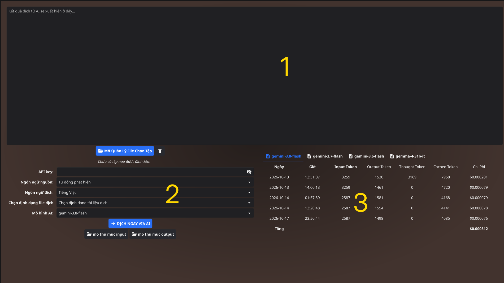

[Title] Hướng dẫn sử dụng phần mềm dịch bằng AI
# Giới thiệu
- Đây là ứng dụng tân dụng sức mạnh của AI để dịch tài liệu, sách giữa các ngôn ngữ khác nhau như Anh <=> Việt, Việt <=> Đức, Việt <=> Trung,...
- Ngôn ngữ hỗ trợ bao gồm 192 ngôn ngữ (hiện tại chỉ bao gồm các ngôn ngữ phổ biến)
- Ai được sử dụng: các mô hình phổ biến, hiện tại chỉ hỗ trợ Gemini và Gemma4 - một biến thể của Gemini nhưng có giá thấp hơn.

## Hướng dẫn sử dụng
- Kết quả dịch sẽ xuất hiện ở phần này.
Phía bên dưới:
- Bên trái là bảng điều khiển, người dùng cần nhập apikey, chọn ngôn ngữ của tài liệu (có thể để "tự động phát hiện"), cọn ngôn ngữ cần dịch, sau đó chọn định dạng file xuất ra và cuối cùng là chọn phiên bản của mô hình AI.
- Sát bên dưới là các nút như mở thư mục input - đây là thư mục lưu các file do người dùng tải lên; mở thư mục output - đây là thư mục lưu các file đã được dịch; kế đến là nút "Lịch sử dịch" để người dùng xem lại kết quả dịch tài liệu; và cuối cùng là nút chi phí để xem số token đã sử dụng và chi phí phải trả cho mỗi lần dịch.
- Bên phải là đơn giá của từng mô hình, thường thì các mô hình AI mới hơn và thông minh hơn sẽ có giá cao hơn, đồng thời nó cũng cho kết quả nhanh hơn và chính sách hơn các mô hình có mức giá rẻ hơn. Lưu ý mức giá này cho 1 triệu tokens, để người dùng dễ hình dung thì khái quát như sau: với 1 triệu token thì có thể dịch được 1 cuốn sách tầm 300 trang, và người dùng phải trả mức cao nhất cỡ $4 (gemini-3.8-flash)

### API key với quota miễn phí

1. Mở trang API keys trong Google AI Studio và đăng nhập.
2. Chọn một project có thể dùng Gemini API hoặc tạo project mới.
3. Chọn **Create API key**, sao chép key và cấu hình theo bước 3 của hệ điều
   hành tương ứng ở trên.
4. Kiểm tra [quota và giới hạn sử dụng](https://ai.google.dev/gemini-api/docs/rate-limits)
   của project/mô hình trước khi dịch.

Quota miễn phí phụ thuộc vào khu vực, project, mô hình và chính sách hiện hành
của Google; không phải mọi mô hình hoặc tài khoản đều có cùng hạn mức. Kiểm tra
trang giá và điều khoản hiện tại trước khi gửi tài liệu:
[Gemini API pricing](https://ai.google.dev/gemini-api/docs/pricing).

### API key với thanh toán

API key không có một loại riêng gọi là “key trả phí”: mức tính phí gắn với
project Google Cloud mà key thuộc về. Để sử dụng theo mức trả phí:

1. Trong Google AI Studio, tạo key thuộc project cần dùng hoặc chọn project đó.
2. Mở [Google Cloud Billing](https://console.cloud.google.com/billing), thiết
   lập tài khoản thanh toán và liên kết tài khoản thanh toán với đúng project.
3. Kiểm tra mô hình có hỗ trợ cho project, giá, quota và giới hạn chi tiêu tại
   [Gemini API pricing](https://ai.google.dev/gemini-api/docs/pricing) và
   [Google AI Studio](https://aistudio.google.com/).
4. Cấu hình key như hướng dẫn hệ điều hành ở trên. Theo dõi mức sử dụng và hóa
   đơn trong Google Cloud; giữ key riêng tư và không đưa vào source code.
